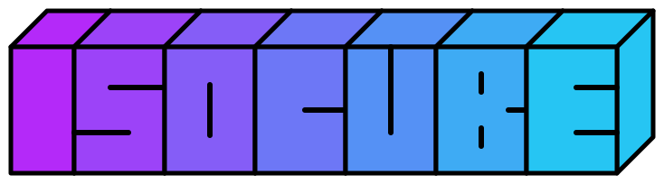
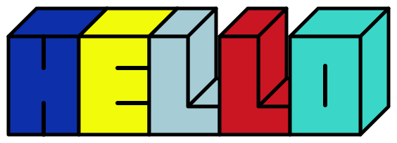
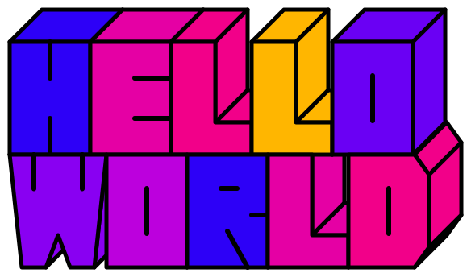
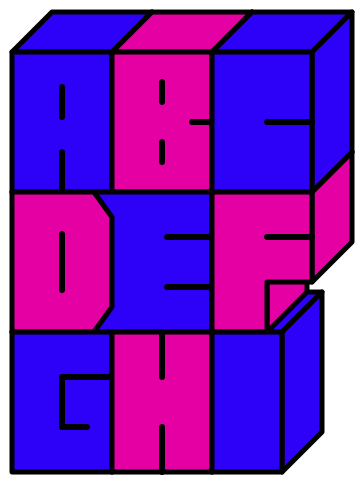
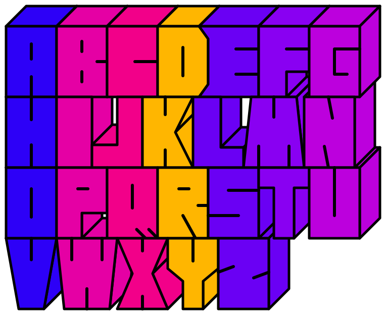

# isocube

[](https://www.npmjs.com/package/isocube)

Generate colorful block-letter logos as transparent SVGs. No API key, external fonts, or runtime dependencies required.



## Usage

One row, random RGB color for each character. Colors vary on each run; the image below is one example.

```sh
npx isocube --text HELLO --out output/hello.svg
```



Reverse the text: HELLO becomes OLLEH.

```sh
npx isocube --text HELLO --reverse --out output/reverse.svg
```

Two rows: hello / world.

```sh
npx isocube --text helloworld --break-at 5 \
  --colors '#2D00F7,#E500A4,#F20089,#FFB600,#6A00F4,#8900F2,#BC00DD' \
  --out output/hello-world.svg
```



Three rows: ABC / DEF / GHI.

```sh
npx isocube --text ABCDEFGHI --break-at 3,6 \
  --colors 'rgb(45,0,247),#E500A4' --out output/repeat-color.svg
```



All 26 letters: four rows of A–Z.

```sh
npx isocube --text ABCDEFGHIJKLMNOPQRSTUVWXYZ --break-at 7,14,21 \
  --colors '#2D00F7,#E500A4,#F20089,#FFB600,#6A00F4,#8900F2,#BC00DD' \
  --out output/alphabet.svg
```



| Option       | Description                                                                                                                                                            |
| ------------ | ---------------------------------------------------------------------------------------------------------------------------------------------------------------------- |
| `--text`     | Required. 1–256 ASCII letters, digits, spaces, or actual newlines. Lowercase becomes uppercase. Spaces leave a blank block.                                            |
| `--reverse`  | Reverse the entire input, including newlines, before applying `--break-at`. Colors follow the resulting character order. Defaults to off.                              |
| `--break-at` | Optional ascending cumulative character positions, e.g. `4` or `3,6`. Cannot be combined with embedded newlines.                                                       |
| `--colors`   | Optional comma-separated `#RGB`, `#RRGGBB`, or `rgb(r,g,b)` colors. A short palette repeats across rows. Defaults to independent random RGB values for each character. |
| `--out`      | SVG output path. Default: `output/logo.svg`. Existing files are overwritten.                                                                                           |
| `--force`    | Accepted for compatibility. Existing files are overwritten by default.                                                                                                 |
| `--help`     | Show usage.                                                                                                                                                            |

## JavaScript API

```js
import { generateLogo } from 'isocube';

const { svg, lines, colors } = generateLogo({
  text: 'SAMPLE',
  breakAt: [4],
  colors: ['#2D00F7', '#E500A4'],
});
```

TypeScript declarations are included.

Pass `reverse: true` to reverse the input before applying `breakAt`, just like the CLI's `--reverse` option.

## Adjust individual letters

Start the editor:

```sh
bun run dev:editor
```

Open <http://127.0.0.1:3334/editor.html> (also printed in the terminal). Set `PORT` to use a different port, for example `PORT=4000 bun run dev:editor`. The playground remains available through `bun run dev:site` on port 3333, with a **Glyph Editor** link.

Select A–Z, 0–9, or Space and edit its width, outline vertices, and cut-line coordinates. Each value has one number input and one synchronized slider, with 0.1-unit steps, plus a reset button that restores that value to its saved setting. The editor shows the saved and edited letter side by side, plus a sample word. On desktop, the controls match the preview panel's height and scroll independently so the preview stays visible while editing lower fields. Colors stay fixed while editing so shape changes are easy to compare.

Click **リポジトリに保存** to write `src/glyphs.json` from the local editor. On the published site, download `glyphs.json` and replace `src/glyphs.json` in your checkout. You can also import a downloaded configuration to continue editing. The editor lists changed characters and supports resetting one letter or all edits. Saving refuses to overwrite a file changed elsewhere since the page was loaded.

Review and share the changes:

```sh
git diff -- src/glyphs.json
bun run ci
git add src/glyphs.json
git commit -m "fix: adjust glyph geometry"
git push
```

The shared JSON configuration supplies the CLI, JavaScript API, playground, and alphabet page after rebuilding. Coordinates use a front face of height 140; X runs right and Y runs down. Width must be 20–240, X must fit the letter width, and Y must be 0–140. Cut lines use absolute `M`, `L`, `H`, and `V` SVG commands. Space has only a width. Letters without an explicit outline use the existing rectangle and D-joining behavior.

For an in-memory preview, pass a complete configuration through the JavaScript API:

```js
import { generateLogo, getDefaultGlyphs } from 'isocube';

const glyphs = getDefaultGlyphs();
glyphs.A.marks = 'M50 30V65 M50 100V140';
const { svg } = generateLogo({ text: 'SAMPLE', glyphs, colors: ['#2D00F7'] });
```

## License

MIT
